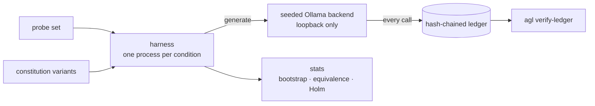

<h1 align="center">agent-governance-lab</h1>

<p align="center">
  A small, auditable harness for experiments on agent governance artifacts<br>
  constitution wording · tiered memory · multi-stage skill review
</p>

<p align="center">
  
  
  
  
  
  
</p>

---

## What this is

Experiments on local models are easy to run and hard to trust: no seed, no record of what was sent,
conditions that quietly share state. This repository is the plumbing that fixes those three things,
so later experiments can be compared fairly.

It sits **above** [contemplative-agent](https://github.com/shentonyan/contemplative-agent)
(a fork of shimo4228/contemplative-agent) and does not modify it.



## Status

No experiment results exist yet. What exists is the core, and it has been run end to end once.

| Component | State |
|---|---|
| Hash-chained run ledger | implemented, tested |
| Seeded, loopback-only Ollama backend | implemented, tested, run against a real model |
| Axiom-4 wording variants (en / zh) | implemented, tested on synthetic text only |
| Statistics: Wilson, exact McNemar, Holm, cluster bootstrap, equivalence, phi | implemented, tested |
| M0 self-check and end-to-end smoke run | passed on one machine, see below |
| Experiments 1–3 | designed, not run; exp 1 has an unfrozen [draft pre-registration](docs/experiments/exp01/PREREG.md) |

### M0 smoke result (2026-10-14)

One local model (`qwen2.5:7b`), Ollama 0.34.2, Windows, 64-token generations, 3 prompts.

| Check | Result |
|---|---|
| Ledger verifies for every run | pass |
| Same seed, 2 runs: identical responses | pass |
| Different seed: responses differ | pass |
| English variants give ≥ 3 distinct texts | pass |

Scope: this shows seeding is repeatable on this machine and build. It says nothing about other
hardware, other Ollama versions, longer generations, or other models. Details:
[`docs/m0/results.md`](docs/m0/results.md).

## Quick start

```powershell
python -m venv .venv
.\.venv\Scripts\Activate.ps1
pip install -e ".[dev]"
pytest
agl self-check --model qwen2.5:7b
python scripts\smoke_e2e.py --model qwen2.5:7b
```

| Command | Purpose |
|---|---|
| `agl self-check --model <tag>` | Ollama reachable, model present, same-seed determinism |
| `agl verify-ledger <file>` | recompute a ledger's hash chain |
| `agl make-variants --axioms <md> --lang en\|zh --out <dir>` | write wording variants of axiom 4 |

## Design rules

1. Upstream is not vendored or edited ([ADR 0001](docs/adr/0001-harness-above-upstream.md)).
2. Every model call goes into a hash-chained ledger ([ADR 0002](docs/adr/0002-seeded-backend-and-ledger.md)).
3. Only loopback endpoints are accepted; system proxies are ignored.
4. Hypotheses, metrics and stopping rules are written before data ([ADR 0003](docs/adr/0003-preregistration.md)).
5. Licenses are respected at the boundary ([ADR 0004](docs/adr/0004-license-boundaries.md)).
6. Raw data and run outputs are never committed ([ADR 0005](docs/adr/0005-data-hygiene.md)).

Known limits are tracked in [`docs/threats-to-validity.md`](docs/threats-to-validity.md).

## Roadmap

- [x] M1: ledger, backend, variants, statistics, CLI, CI
- [x] M0 smoke on one machine
- [ ] Fix probe set and scoring rubric; freeze exp 1 pre-registration
- [ ] Exp 1: axiom-4 wording comparison
- [ ] Exp 2: tiered memory prototype vs an external memory service
- [ ] Exp 3: multi-stage skill review pipeline

## Layout

```
src/agent_governance_lab/   library and CLI
tests/                      unit tests (no network, no model)
docs/adr/                   architecture decision records
docs/experiments/           pre-registrations and protocols
docs/m0/                    environment check results
scripts/                    setup, upstream fetch, smoke run
```

## License

MIT for this repository's own code and text. Upstream material keeps its own licenses:
[`THIRD_PARTY.md`](THIRD_PARTY.md).
